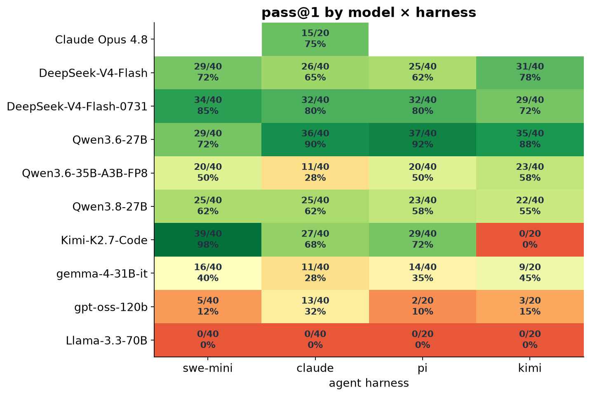
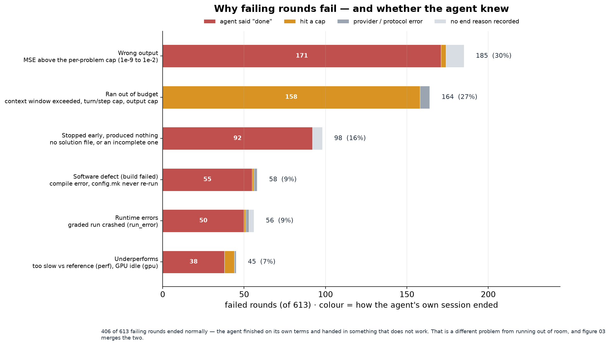
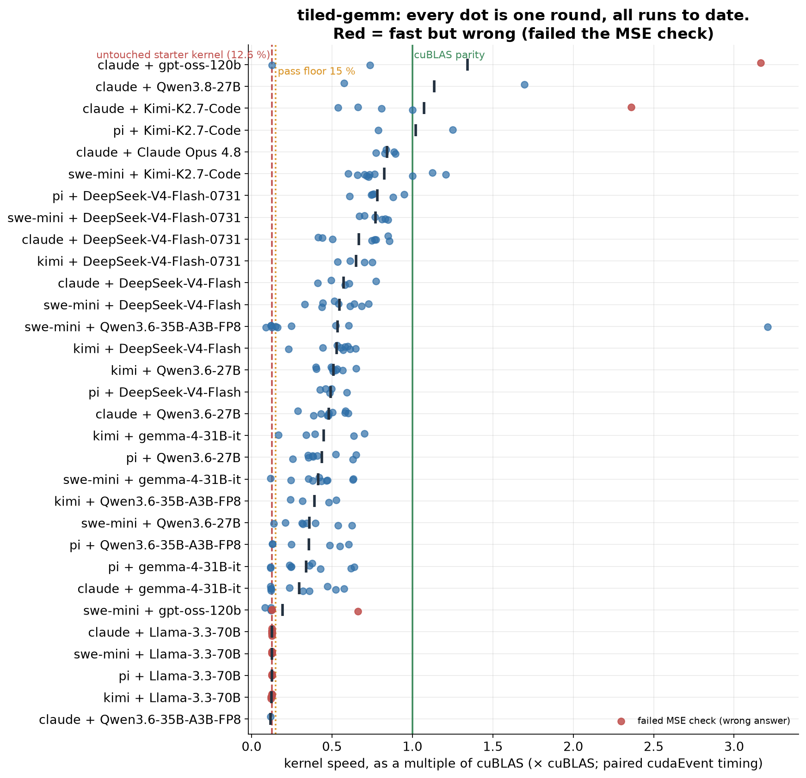
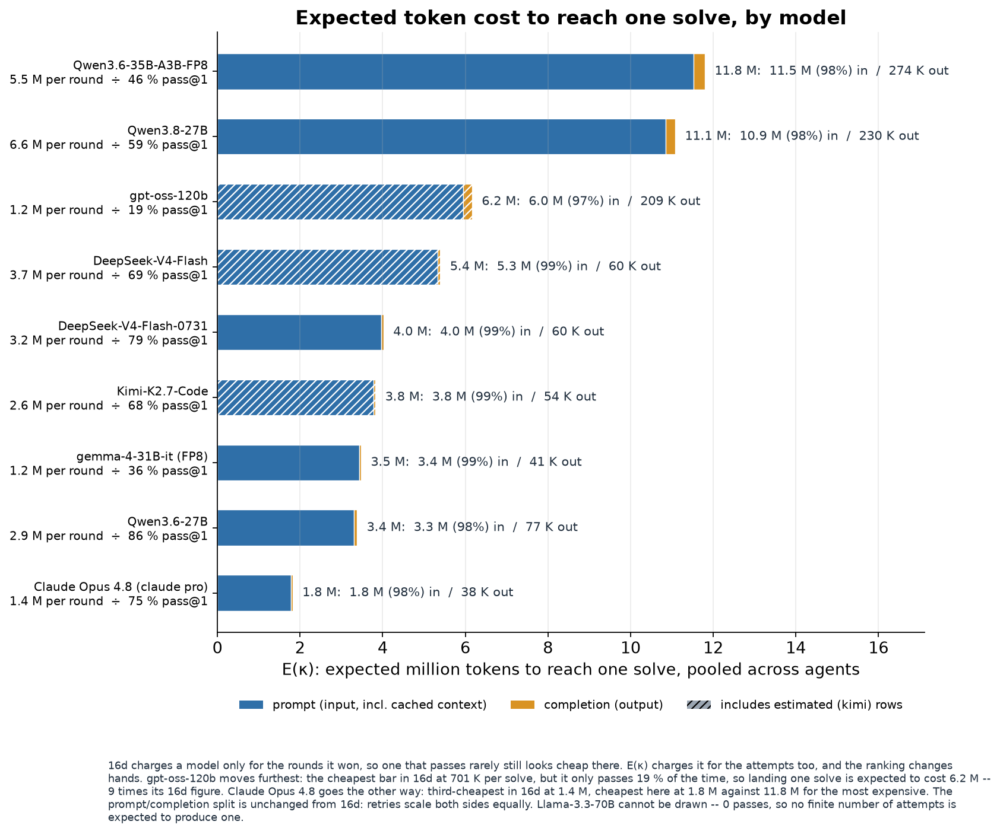

# Coding-agent evaluation harness

Runs four coding agents (Claude Code, Kimi Code, pi, mini-swe-agent) on the same programming
problems against any OpenAI-compatible endpoint, replays and grades every solution on the host, and
reports pass@1, token use and failure causes. Problems are CUDA/CPU performance tasks with a
verifier. The repo also contains the SGLang + LiteLLM serving stack used to host the models and the
original author's results.

## Quickstart

Needs Linux, Apptainer with fakeroot, Python 3 with PyYAML, `jq`, `curl`, and an NVIDIA GPU for the
GPU problems.

```bash
cp endpoints.yaml.example endpoints.yaml && cp .env.example .env    # add your endpoint, model and key
apptainer build --fakeroot agents/apptainer/pi/agent.sif agents/apptainer/pi/agent.def   # per agent
tests/endpoint/run.sh --endpoint default --model my-model           # does the endpoint work, what does it cost
EVAL_AGENT=pi EVAL_ENDPOINT=default EVAL_MODELS=my-model EVAL_ROUNDS=3 \
  EVAL_PROBLEMS=tiled-gemm scripts/run_eval.sh
python3 tools/summarize.py
```

## Layout

| Path | Purpose |
|---|---|
| `endpoints.yaml`, `.env` | your endpoints, models, keys (from the `*.example` files) |
| `agents/apptainer/` | one directory per agent: image recipe, orchestrator, in-container runner |
| `problems/` | the problems, plus `_template/` for new ones |
| `checks/` | host-side graders and trace statistics, plus `_template/` |
| `scripts/` | `run_eval.sh` entry point, SLURM wrapper, endpoint resolver |
| `tests/endpoint/` | endpoint test: protocol probes and one real round per agent, with token cost |
| `tools/` | `summarize.py`, `collect_results.py`, `trace-vis/` trajectory viewer |
| `serving/` | SGLang, LiteLLM, Prometheus and Grafana for SLURM clusters |
| `docs/` | `EXTEND_PROMPT.md`, `gotchas.md`, `results-schema.md` |
| `reference-results/` | the original results. Delete this folder and nothing else breaks. |

## Extending it with your coding agent

Point your agent at [AGENT.md](AGENT.md), which describes what is where, and give it the prompt in
[docs/EXTEND_PROMPT.md](docs/EXTEND_PROMPT.md) with a description of your problem. It creates the
problem and its grader, runs the endpoint test, and keeps AGENT.md up to date.

## Example results

Produced by the scripts in `reference-results/analysis/`. Give a picture to your agent and ask it to
rebuild it from your own `results/runs.jsonl`.

| | |
|---|---|
|  |  |
| pass@1 per model and agent | why failing rounds fail, and whether the agent knew |
|  |  |
| every round of one problem against a cuBLAS reference | expected token cost per solved problem |

More in `reference-results/figures/`. Full traces are release assets, see
`reference-results/README.md`.
